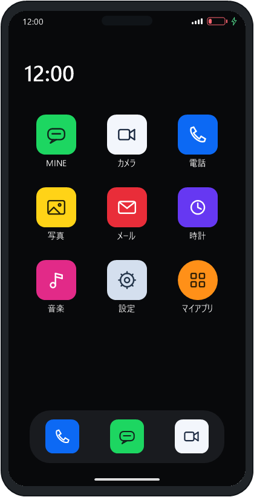
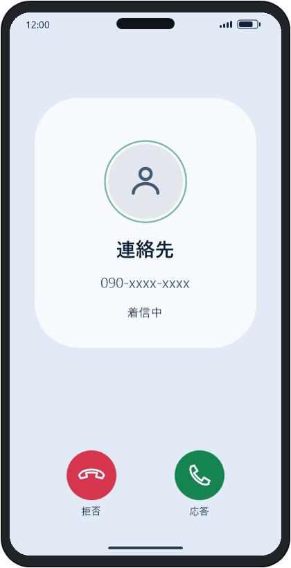
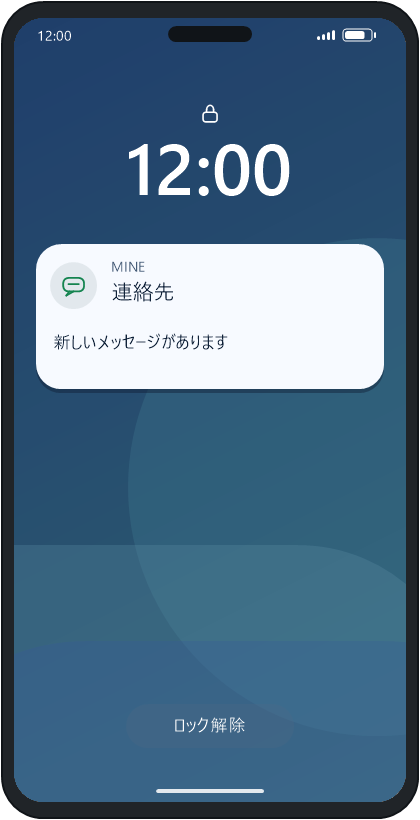

# スマホ演出（SYNC_PhoneFX）

AviUtl ExEdit2 のタイムラインに、スマートフォンの画面と効果音を追加するメディアオブジェクトです。ホーム画面、電話、通知、アプリ起動など、23種類の演出を選べます。

| ホーム画面・充電中 | 電話着信 | MINE・SNS受信通知 |
| --- | --- | --- |
|  |  |  |

## インストール

**対応環境**　Windows 64-bit、AviUtl ExEdit2 2.1.16 以降

1. [GitHub Releases](https://github.com/vramwiz/SYNC_PhoneFX/releases) から `SYNC_PhoneFX.zip` をダウンロードして展開します。
2. AviUtl2 を終了し、展開した `SYNC_PhoneFX` フォルダーを AviUtl2 の `Plugin` フォルダーにコピーします。通常の配置先は `C:\ProgramData\aviutl2\Plugin\SYNC_PhoneFX` です。
3. AviUtl2 を起動し、「スマホ演出」をメディアオブジェクトとしてタイムラインに追加します。初期設定では「電話着信」が選ばれています。

更新時は同じ場所にコピーします。アンインストール時は AviUtl2 を終了してから、配置したプラグインフォルダーを削除します。組み込みキャラから生成した顔アイコンの保存先は、マイドキュメントの `SYNC_PhoneFX\Icons` です。

## 選べる演出

| 種類 | 演出スタイル |
| --- | --- |
| 基本操作 | ホーム画面、画面点灯、画面消灯、ロック解除 |
| 電話 | 電話番号入力、電話発信、電話着信、通話開始、音声通話中、ビデオ通話中、話し中、着信拒否、通話終了 |
| 通知 | MINE・SNS受信通知、一般アプリ通知、不在着信通知 |
| アプリ起動 | MINE起動、カメラ起動、任意のアプリ起動 |
| その他 | アラーム、アラーム停止、充電開始、バッテリー残量警告 |

## タイムラインでの使い方

- **タイミングを合わせる**　「スマホ設定」の「演出開始までの待ち時間 (秒)」は初期値0.50秒です。オブジェクトの配置位置を保ったまま、演出と効果音の開始を0〜60秒の範囲で調整できます。着信・呼出・話し中・アラームはオブジェクトの終端まで繰り返します。
- **電話をつなぐ**　「電話番号入力」→「電話発信」→「通話開始」→「音声通話中」→「通話終了」のように並べます。電話番号には `090-xxxx-xxxx` のような伏せ字も使えます。通話タイマーをつなぐには、次のオブジェクトの「通話開始時の経過時間 (秒)」を調整します。
- **ビデオ通話を合成する**　「ビデオ通話中」は画面中央が透明です。相手の映像を背面のレイヤーに置き、AviUtl2 の標準描画でスマホ枠に合わせます。マイク・カメラ・スピーカーの状態は「電話」グループで設定できます。
- **通知を出す**　「通知」グループでアプリ名、送信者、本文を設定します。顔アイコンは組み込みキャラまたは画像から選べます。画像を指定した場合は、その画像が優先されます。
- **自作のアプリを起動する**　「アプリ起動」グループで「アプリアイコン画像ファイル」と「起動するアプリ名」を指定します。ホーム画面右下の円形アイコンの中で、画像の位置と拡大率を調整できます。「任意のアプリ起動」を選ぶとそのアイコンをタップします。

## 画面と音の調整

- **画面**　「表示時刻」は初期値12:00で、オブジェクトの経過時間に合わせて進みます。電波強度、壁紙、ダークモードも指定できます。バッテリー残量が20％以下になると赤くなり、「充電中」にチェックを入れると緑の稲妻が点灯します。
- **筐体と画像**　「スマホ設定」で筐体の色や表示の有無を選べます。オブジェクトの位置、拡大率、回転、透明度は AviUtl2 の標準描画で調整します。壁紙・顔アイコン・アプリアイコンは PNG、JPEG、BMP、GIF の静止画像に対応します。
- **音とタップ**　効果音の音量は0〜100で、既定値は50です。着信音の種類、バイブレーション、タップ音や波紋の表示を個別に調整できます。

## ライセンス

Copyright (c) 2026 VRAMの魔術師

プログラムのソースコードは GNU General Public License v3.0（GPL-3.0）です。配布ZIPにもライセンス本文を収録しています。[ライセンス全文](LICENSE) · [使用コンポーネントと素材](THIRD_PARTY_NOTICES.md) · [v1.0.0 のソースコード](https://github.com/vramwiz/SYNC_PhoneFX/tree/v1.0.0)

着信音、通知音、アラーム、タップ音などはすべて本プラグインの自作波形を合成して生成します。生成した効果音は動画作品に使用できます。組み込みのキャラクターや利用者が指定する画像には、各素材の利用条件が適用されます。
